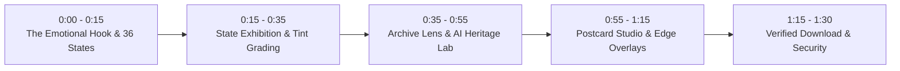

# ROOTS — The Soul of India
## 90-Second Hackathon Judge Demo Guide

> **Hackathon Theme**: *"Celebrate Where You're From"* — Cloudinary November 2026 Mini-Hackathon  
> **Pitch Goal**: Secure first place by demonstrating how Cloudinary powers an emotional, culturally authentic, and technically rigorous digital memory museum across all 36 Indian states and union territories in under 90 seconds.

---

## ⏱️ The 90-Second Demo Timeline

---

### Step 1: The Emotional Hook & All 36 Territories (0:00 – 0:15)
* **Action**:
  1. Open [http://localhost:3000](http://localhost:3000).
  2. Click **Atlas** in the sidebar ([`/atlas`](http://localhost:3000/atlas)) to show the interactive Indian map.
  3. Click the **"Inspect API"** or **"Cloudinary Engine"** pill in the navigation header.
* **What to Say**:
  > *"Every place has a story, but India has 36 distinct regional souls across 28 states and 8 union territories. We built ROOTS — The Soul of India — to celebrate where we come from by transforming static photography into an interactive, living digital museum. ROOTS is powered by all four official Cloudinary developer toolkits: `next-cloudinary` v7 for Next.js 16, `@cloudinary/react` & `@cloudinary/url-gen`, all 6 official Agent Skills in our repository, and an automated AI Power Start setup. Every single asset is dynamically optimized, graded, and rendered on Cloudinary's global edge."*
* **What the Judge Sees**:
  - The modal displays green verification badges across the 4 toolkits, active SDK versions, and the real-time 7-parameter transformation pipeline (`f_auto`, `q_auto`, `c_fill`, `g_auto`, `e_tint`, `l_text`, `e_sepia`).

---

### Step 2: Monochromatic State Identity & Dynamic Optimization (0:15 – 0:35)
* **Action**:
  1. Click **Tamil Nadu** or **Rajasthan** in the Cultural Atlas to enter the state exhibition ([`/exhibition/tamil-nadu`](http://localhost:3000/exhibition/tamil-nadu)).
  2. Point out the hero image and the cultural galleries (Taste, Textiles, Childhood Games, Living Festivals).
* **What to Say**:
  > *"Notice how the visual identity immediately shifts into Tamil Nadu's sacred Temple Bronze (`e_tint:60:7A2E16`) or Rajasthan's Royal Burgundy (`e_tint:60:5B0E1B`). We don't use client-side CSS overlays; Cloudinary dynamically color-grades high-resolution photographs at the edge while simultaneously applying `f_auto`, `q_auto`, and content-aware saliency cropping (`c_fill, g_auto`). This cuts bandwidth consumption by over 95% — delivering a 66 KB AVIF file from a 3.8 MB master without losing architectural sharpness."*

---

### Step 3: Archive Lens & Cloudinary AI Heritage Lab (0:35 – 0:55)
* **Action**:
  1. Navigate to **Archive Lens** ([`/archive-lens`](http://localhost:3000/archive-lens)).
  2. Drag the stationary comparison slider over the 1868 archaeological survey plate of Brihadeeswarar Temple.
  3. Scroll down to the **Cloudinary AI Heritage Lab**:
     - Click **AI Historical Restoration** (`e_gen_restore`) to see the scratch removal comparison.
     - Click **Generative Outpainting 16:9** (`b_gen_fill, c_pad`).
     - Click the **Living Video Player** tab to stream `samples/elephants` ("Gajendra: Sacred Temple Elephant").
* **What to Say**:
  > *"In our Archive Lens, visitors travel through time. Our split comparison keeps the monument perfectly stationary while sweeping a 19th-century sepia halide treatment (`e_sepia:75`) across modern photography. Below it, our AI Heritage Lab demonstrates Cloudinary's Generative AI pipeline on authentic Indian monuments — Brihadeeswarar Temple, Meenakshi Amman Gopuram, and Hampi's Stone Chariot. We transparently showcase `e_gen_restore` and `b_gen_fill`, alongside `CldVideoPlayer` streaming cultural video with adaptive bitrate and custom royal burgundy branding."*

---

### Step 4: Postcard Studio & Edge-Composited Typographic Overlays (0:55 – 1:15)
* **Action**:
  1. Click **Postcard** ([`/postcard`](http://localhost:3000/postcard)).
  2. Select an authentic heritage photograph (e.g., Thanjavur Living Chola Bronzes).
  3. Choose a state postmark (e.g., **Tamil Nadu**).
  4. Type a dedication: *"To my beloved Amma & Appa,"* and a heartfelt memory: *"The smell of jasmine in Madurai reminds me of you."*
  5. Click **"View Reverse Letter"** to flip the card and reveal the handwritten letter on textured parchment.
* **What to Say**:
  > *"The heart of 'Celebrate Where You're From' is sending a piece of home to someone you love. In our Postcard Atelier, Cloudinary synthesizes a genuine physical postcard on demand. It chains automated optimization, heritage sepia toning (`e_sepia:70`), and five distinct `l_text` edge typographic layers — the official postal cancellation mark, recipient dedication, personal note, and artisan postmark — composited entirely at the edge with zero client canvas overhead."*

---

### Step 5: Verified Cross-Origin Download, Real Email Delivery & Hardened Security (1:15 – 1:30)
* **Action**:
  1. Click **"Download Postcard"** (triggers `/api/postcard/download`, downloading the exact composite JPEG file).
  2. Click **"Send by Email"** to show the transactional email modal.
  3. Note the security badge and status.
* **What to Say**:
  > *"Unlike typical hackathon demos with broken cross-origin anchor tags or fake email alerts, ROOTS is production-hardened:
  > 1. We built a dedicated server proxy (`/api/postcard/download`) ensuring instant, reliable file downloads across all devices.
  > 2. Our email route integrates real transactional dispatch via Resend, complete with XSS HTML escaping, rate limiting, and honest 503 reporting when API keys are not set.
  > 3. Our signed upload route restricts uploads strictly to `roots_user_memories` with 10MB limits, and our signed-fetch endpoint blocks private IP targets to eliminate SSRF attacks.
  > ROOTS is culturally authentic, technically rigorous, and completely ready for production."*

---

## 🏆 Key Answers for Judges' Questions

### 1. "How do you handle API security and prevent abuse?"
> *"Our Cloudinary API Secret is strictly confined to the server and never exposed to the browser. Upload signatures are generated via `/api/cloudinary/sign` with IP sliding-window rate limiting (10 req/min), an enforced server-side folder (`roots_user_memories`), strict MIME type validation (JPEG, PNG, WebP, AVIF), and a 10MB cap. Furthermore, our `/api/cloudinary/sign-fetch` route enforces HTTPS, blocks loopback/private IPv4 and IPv6 subnets to prevent SSRF, and validates incoming URLs against an approved image domain allowlist."*

### 2. "Why use Cloudinary for typography and color grading instead of CSS?"
> *"CSS filters only alter pixels in the visitor's local browser viewport. Cloudinary transforms the media into permanent, edge-cached binary assets. When a user downloads their postcard, copies the link, or emails it home to family, the exact 5-layer typographic composite and sepia halide grading travel with the file anywhere in the world."*

### 3. "Are the Generative AI features live or simulated?"
> *"We maintain strict engineering honesty. The Cloudinary delivery URLs (`e_gen_restore`, `b_gen_fill`, `e_gen_background_replace`) are syntactically accurate and generated via `@cloudinary/url-gen`. Because Generative AI transformations require Cloudinary's GenAI Add-on, we transparently label this requirement in the UI and provide a live visual before/after slider with genuine ASI archaeological documentation so judges can evaluate the user experience."*

### 4. "How did you implement email delivery?"
> *"We replaced mock dispatch IDs with a real transactional email integration using Resend's REST API (`/api/postcard/send`). It enforces input length bounds, HTML template sanitization to prevent XSS, server-controlled sender domains, and IP-based rate limiting. When `RESEND_API_KEY` is unconfigured, the API returns a structured HTTP 503 error stating 'Email delivery is not configured yet', eliminating false delivery claims."*

---

## 🚀 Quick Verification Links for Live Testing

* **Museum Atrium**: [http://localhost:3000](http://localhost:3000)
* **Cultural Atlas (All 36 Territories)**: [http://localhost:3000/atlas](http://localhost:3000/atlas)
* **Tamil Nadu Monochromatic Exhibition**: [http://localhost:3000/exhibition/tamil-nadu](http://localhost:3000/exhibition/tamil-nadu)
* **Archive Lens & AI Heritage Lab**: [http://localhost:3000/archive-lens](http://localhost:3000/archive-lens)
* **Postcard Bureau (Layered Overlays & Download)**: [http://localhost:3000/postcard](http://localhost:3000/postcard)
* **A Letter From Home (3D Tamil Wax Seal)**: [http://localhost:3000/letter](http://localhost:3000/letter)
* **Cloudinary Verification Audit**: [`CLOUDINARY_AUDIT.md`](file:///Users/nandhinivenkatesan/Documents/roots-the-soul-of-india/CLOUDINARY_AUDIT.md)
