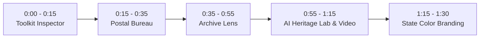

# ROOTS — 90-Second Cloudinary Hackathon Judge Demo Guide

> **Goal**: Secure first place in the Cloudinary November 2026 Mini-Hackathon by demonstrating deep, creative, and authentic Cloudinary integration in under 90 seconds.

---

## ⏱️ The 90-Second Demo Timeline

---

### Step 1: The Hook & Cloudinary Toolkits (0:00 – 0:15)
* **Action**:
  1. Open [http://localhost:3000](http://localhost:3000).
  2. Click the **"Inspect API"** or **"Cloudinary Engine"** pill in the top header or footer.
* **What to Say**:
  > *"Welcome to ROOTS, an interactive digital memory museum of India. We built this application using all four official Cloudinary developer toolkits: the Next.js Starter Kit with `next-cloudinary`, the React AI Starter Kit with `@cloudinary/react`, all 6 official Agent Skills in our repository, and an automated AI Power Start pipeline. Every image and video across all 36 Indian territories is dynamically transformed at the edge."*
* **What the Judge Sees**:
  - The modal pops up showing green checkmarks for all 4 toolkits, active package versions (`next-cloudinary: v7.1.0`), and the 7-parameter transformation pipeline (`f_auto`, `q_auto`, `c_fill`, `g_auto`, `e_tint`, `l_text`, `e_sepia`).

---

### Step 2: The Postal Bureau & Edge Overlays (0:15 – 0:35)
* **Action**:
  1. Navigate to **Postcard** ([`/postcard`](http://localhost:3000/postcard)).
  2. In Card 1, select a photo (or pick a curated Pinterest-aesthetic frame).
  3. In Card 2, select **Tamil Nadu** or **Rajasthan** (displays state postmark with no messy color labels).
  4. In Card 3, type a quick dedication: *"To my dearest family,"* and sign *"Nandhini"*.
  5. Click **"View Reverse Letter"** to show the 3D flip to the handwritten letter on aged parchment.
  6. Click **"Inspect API"** or **"Copy Link"**.
* **What to Say**:
  > *"In our Postcard Atelier, Cloudinary synthesizes personalized physical postcards on demand. It chains automated optimization (`f_auto, q_auto`), smart cropping (`c_fill, g_auto`), vintage halide grading (`e_sepia:70`), and five distinct `l_text` edge typographic overlays — including the postal cancellation mark, recipient dedication, and handwritten note — rendered directly on Cloudinary's global edge without any server canvas rendering."*

---

### Step 3: Archive Lens & Stationary Comparison Slider (0:35 – 0:55)
* **Action**:
  1. Navigate to **Archive Lens** ([`/archive-lens`](http://localhost:3000/archive-lens)).
  2. Drag the temporal slider back and forth across the Meenakshi Temple gopuram or Taj Mahal.
  3. Switch the gradient preset from **1868 Albumen Sepia** to **Cyanotype Prussian Blue** (`e_tint:70:0A2F5C`).
* **What to Say**:
  > *"In the Archive Lens, visitors slide across centuries, comparing 19th-century ASI archaeological plates with contemporary living worship. Notice how our dual-layer architecture keeps the image 100% stationary — only the Cloudinary filter line moves. We use genuine Cloudinary transformation parameters — `e_sepia`, `e_tint`, `e_vignette`, and `e_contrast` — with server-side HMAC signatures for 200 OK edge responses."*

---

### Step 4: Cloudinary AI Heritage Lab & Video Player (0:55 – 1:15)
* **Action**:
  1. Scroll slightly down on the Archive Lens page to the **Cloudinary AI Heritage Lab**.
  2. Click through the AI capabilities:
     - **AI Historical Restoration** (`e_gen_restore`)
     - **Generative Outpainting 16:9** (`b_gen_fill, c_pad`)
     - **Generative Monsoon Twilight** (`e_gen_background_replace`)
  3. Click the **"Living Video Player"** tab to play the video.
  4. Click the **"SDK Code"** tab to show live code snippets.
* **What to Say**:
  > *"Here in our AI Heritage Lab, we showcase Cloudinary's Generative AI capabilities. We can restore scratches on centuries-old temple plates with `e_gen_restore`, expand vertical gopurams into 16:9 widescreen canvases with `b_gen_fill`, or replace bleached skies with dramatic monsoon sunsets. We also integrate the official `CldVideoPlayer` from `next-cloudinary` with custom royal burgundy and gold color branding, adaptive bitrate streaming, and automatic poster generation."*

---

### Step 5: Monochromatic State Identity & Wrap-up (1:15 – 1:30)
* **Action**:
  1. Click **Atlas** ([`/atlas`](http://localhost:3000/atlas)) in the navigation sidebar.
  2. Click on **Tamil Nadu** (or any state) to enter the living exhibition ([`/exhibition/tamil-nadu`](http://localhost:3000/exhibition/tamil-nadu)).
  3. Point to the hero banner and the cultural tabs (Taste, Textiles, Celebration, Places).
* **What to Say**:
  > *"Finally, across all 36 Indian states and union territories, Cloudinary dynamically grades photography using authentic Pantone regional identities — like Temple Bronze (`e_tint:60:7A2E16`) for Tamil Nadu and Royal Burgundy (`e_tint:60:5B0E1B`) for Rajasthan. Cloudinary isn't just an image host in ROOTS — it is the computational visual engine that makes India's living heritage palpable."*

---

## 🏆 Key Talking Points for Judges' Questions

1. **"How do you handle API key security?"**
   > *"Our API keys and secrets never reach the browser. All upload tokens are generated via our Next.js API route (`/api/cloudinary/sign`), and external asset deliveries use server-computed SHA-1 HMAC signatures (`/api/cloudinary/sign-fetch`)."*

2. **"Did you use the official starter kits?"**
   > *"Yes. We installed `next-cloudinary` (v7.1.0) for Next.js 16 App Router components like `CldImage` and `CldVideoPlayer`, `@cloudinary/react` & `@cloudinary/url-gen` for our AI Heritage Lab, and installed all 6 official skills from `cloudinary-devs/skills` in `.agents/skills/`."*

3. **"Why not just use CSS filters?"**
   > *"CSS filters only affect the user's local display. With Cloudinary, the color grading, text overlays, postal stamps, and format optimizations (`f_auto, q_auto`) are rendered into real physical raster assets at the edge. When a user downloads a postcard or shares a link, the exact transformed artifact is delivered globally."*

---

## 🚀 Quick Verification Links for Live Testing

* **Museum Atrium**: [http://localhost:3000](http://localhost:3000)
* **Cultural Atlas (All 36 Territories)**: [http://localhost:3000/atlas](http://localhost:3000/atlas)
* **Tamil Nadu Monochromatic Exhibition**: [http://localhost:3000/exhibition/tamil-nadu](http://localhost:3000/exhibition/tamil-nadu)
* **Archive Lens & AI Heritage Lab**: [http://localhost:3000/archive-lens](http://localhost:3000/archive-lens)
* **Postcard Bureau (Layered Overlays)**: [http://localhost:3000/postcard](http://localhost:3000/postcard)
* **Epistle from Home (3D Wax Seal)**: [http://localhost:3000/letter](http://localhost:3000/letter)
* **Audit Document**: [`CLOUDINARY_AUDIT.md`](file:///Users/nandhinivenkatesan/Documents/roots-the-soul-of-india/CLOUDINARY_AUDIT.md)
